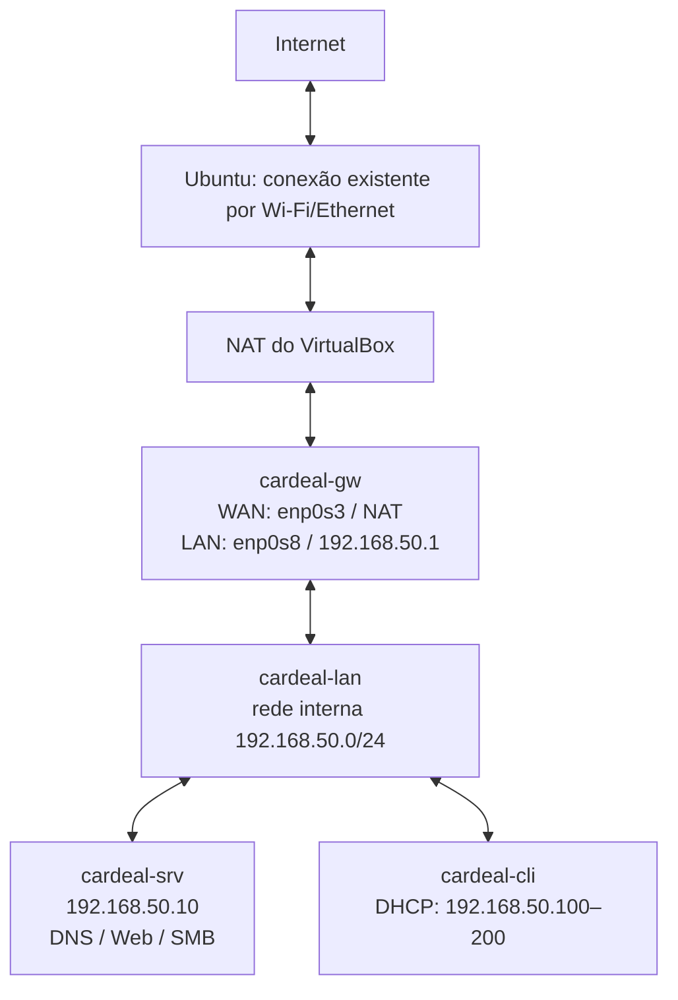

# Cardeal Ltda — trabalho de Redes de Computadores

Planejamento baseado em [Trabalho Infraestrutura.pdf](Trabalho%20Infraestrutura.pdf).

- [Plano de implementação](docs/PLANO_DE_IMPLEMENTACAO.md): requisitos, topologia, endereçamento, sequência de execução, testes, capturas e entregas.
- [Plano de sprints](sprints.md): três entregas funcionais cumulativas, versões, tarefas e critérios de aceite.
- [Ferramentas e gratuidade](docs/FERRAMENTAS.md): inventário completo da stack escolhida, pacotes, instalação por máquina, licenças e compatibilidade.
- [Requisitos de sistema](requirements.txt): ferramentas e pacotes agrupados por hospedeiro e VM, incluindo os componentes da instalação base.
- [Configuração de exemplo](config/lab.env.example): parâmetros de rede, recursos e acesso administrativo previstos.
- [Preparação do ambiente](docs/PREPARACAO_DO_AMBIENTE.md): instalação, simulação e verificação das dependências do hospedeiro e das VMs.

Versão **v0.2.0**: rede básica, intranet Web e compartilhamento SMB. O [aceite da segunda rodada](evidencias/v0.2.0/STATUS.md) registra os resultados nas VMs reais; o [relatório](logs/rodada-2/RELATORIO.md) explica configuração, testes e captura HTTP. A primeira etapa foi publicada no commit `de1cebb` (`feat: DHCP, DNS e gateway`); suas [evidências](evidencias/v0.1.0/STATUS.md) permanecem preservadas.

A proposta usa **VirtualBox + três VMs Debian 13 sem interface gráfica**, executadas no Ubuntu 26.04 LTS atual. O conjunto atende ao laboratório local sem serviços pagos, assinatura, cartão de crédito ou cotas de SaaS. A RAM das VMs precisa ser validada com os serviços em execução.

## Executar o laboratório

A versão entrega DHCP, DNS interno/externo, gateway/NAT, intranet em `http://www.cardeal.local/` e SMB autenticado em `//files.cardeal.local/compartilhado`. O cliente Debian é acessível por terminal SSH. O serviço de e-mail será implementado na Sprint 3; o registro DNS `mail` já existe.

Na raiz do projeto, como usuário normal do Ubuntu:

```bash
./lab.sh preparar      # primeira vez: baixar/verificar imagem, criar e provisionar
./lab.sh iniciar       # iniciar as três VMs já preparadas
./lab.sh atualizar     # atualizar VMs da v0.1.0 com Web/SMB, sem recriar discos
./lab.sh cliente       # abrir o terminal do cliente pela LAN, via gateway
```

Depois de `./lab.sh cliente`, o prompt `cardeal@cardeal-cli:~$` indica que você está **dentro da VM Debian**. Nesse terminal:

```bash
./lab.sh testar       # verificar rede, Web, transferência e autenticação SMB
./lab.sh testar-intranet # verificar somente Web e SMB
./lab.sh status       # endereços e rotas do cliente
ip -br address
ip route
getent hosts www.cardeal.local
dig @192.168.50.10 cardeal.local MX
curl -I https://deb.debian.org/debian/
curl http://www.cardeal.local/
sudo smbclient //files.cardeal.local/compartilhado -A /etc/cardeal/credentials/ana.auth -c ls
exit
```

O atalho `cardeal-lab testar` também funciona em qualquer diretório da VM. O teste local verifica DHCP, DNS, acesso externo e os novos serviços Web/SMB, quando configurados. Para a verificação adicional das NICs VirtualBox e da rede do hospedeiro, use o comando de testes no Ubuntu.

**No terminal Ubuntu, na pasta do projeto**, execute a administração das VMs e os testes completos. Se estiver no prompt do cliente, digite `exit` primeiro:

```bash
./lab.sh status        # estado das VMs e IP atual do cliente
./lab.sh testar        # aceite cumulativo de rede e intranet; conferir rede do Ubuntu
./lab.sh testar-intranet # HTTP, Ana → Bruno, SHA-256 e recusas SMB
./lab.sh testar-persistencia # reiniciar e reaplicar; comparar dados/permissões/contas
./lab.sh reiniciar     # reiniciar as VMs e repetir o aceite
./lab.sh capturar      # DHCP DORA, DNS e HTTP
./lab.sh capturar-http # somente handshake, GET/Host e HTTP 200 da intranet
./lab.sh analisar      # analisar novamente as capturas existentes
./lab.sh testar-falha  # desligar só o gateway virtual, testar e religá-lo
./lab.sh parar         # desligamento ACPI somente das VMs do projeto
```

A imagem oficial Debian e seu SHA-512 estão fixados em [config/debian-image.json](config/debian-image.json). NoCloud configura os convidados por uma pequena ISO local de dados. A automação usa Python 3 da distribuição, xorriso, xz-utils, OpenSSL, curl, SSH e VirtualBox, sem dependências pip nem serviços de nuvem.

Discos, seeds, catálogo VirtualBox e chaves exclusivas ficam em `vms/`, ignorado pelo Git. `lab.sh` seleciona esse catálogo próprio, em vez do catálogo padrão do VirtualBox. O usuário SSH é `cardeal` por padrão; a credencial para uma eventual sessão pelo console está no arquivo local privado `vms/.runtime/acesso-console.json`, sem entrar no Git.

Somente o gateway mantém NAT depois do bootstrap. O SSH fica vinculado a `127.0.0.1:2222` no hospedeiro. A criação não configura bridge, host-only, rotas, DNS, firewall ou interfaces físicas do Ubuntu. A automação registra e compara a rede do hospedeiro antes/depois.

## Onde estão as máquinas virtuais

O laboratório possui **três VMs locais**. Cada uma tem uma pasta própria dentro de `vms/`, na raiz deste projeto:

```text
vms/
├── cardeal-gw/               # gateway, DHCP e saída para a internet
│   ├── cardeal-gw.vbox       # definição da VM no VirtualBox
│   ├── disk.vdi              # disco virtual do Debian e seus dados
│   ├── seed.iso              # configuração inicial NoCloud
│   ├── seed/                 # arquivos usados para gerar a seed
│   ├── serial.log            # saída do console durante o boot
│   └── Logs/                 # registros do VirtualBox
├── cardeal-srv/              # DNS, Apache e Samba
│   ├── cardeal-srv.vbox
│   ├── disk.vdi
│   └── ...                   # seed e logs da própria VM
├── cardeal-cli/              # cliente DHCP e testes dos serviços
│   ├── cardeal-cli.vbox
│   ├── disk.vdi
│   └── ...
├── .virtualbox/              # catálogo VirtualBox exclusivo deste projeto
├── .ssh/                    # configuração e chaves SSH do laboratório
├── .runtime/                # arquivos auxiliares da automação
└── lab-state.json            # identificação das VMs e IP descoberto do cliente
```

O arquivo `.vbox` descreve recursos e adaptadores da VM. O `disk.vdi` contém o sistema operacional, os pacotes, as configurações e os dados gravados dentro daquele Debian. A `seed.iso` fornece os dados iniciais ao cloud-init; o sistema instalado inicia pelo disco VDI.

`vms/` e `isos/` são diretórios locais ignorados pelo Git. Por isso, os discos das VMs **não aparecem no GitHub**. O repositório contém os scripts e templates que os criam. Em uma nova cópia do projeto, `./lab.sh preparar` baixa/verifica a imagem base em `isos/`, cria os discos e provisiona os convidados.

O ponto de entrada [lab.sh](lab.sh) executa [src/host/lab.py](src/host/lab.py), que chama `VBoxManage` e seleciona o catálogo `vms/.virtualbox/`. Para listar as VMs desse catálogo, execute na raiz do projeto, no Ubuntu:

```bash
VBOX_USER_HOME="$PWD/vms/.virtualbox" VBoxManage list vms
```

Para visualizar esse mesmo catálogo na interface gráfica do VirtualBox:

```bash
VBOX_USER_HOME="$PWD/vms/.virtualbox" VirtualBox
```

O VirtualBox aberto com seu catálogo padrão pode mostrar outra lista de máquinas. A administração prevista para este laboratório continua disponível em `./lab.sh iniciar`, `status`, `cliente` e `parar`.

## Como as VMs se conectam à rede

As conexões finais foram conferidas nos arquivos `.vbox`. Todos os adaptadores LAN pertencem à mesma **rede interna VirtualBox**, chamada `cardeal-lan`. Ela faz a comunicação Ethernet entre os convidados e permanece separada das interfaces físicas do Ubuntu.

| VM | Adaptador / interface no Debian validado | Conexão | Endereço e função |
| --- | --- | --- | --- |
| `cardeal-gw` | 1 / `enp0s3` | NAT VirtualBox, lado WAN | IP por DHCP do NAT; observado `10.0.2.15/24` no aceite. Saída externa. |
| `cardeal-gw` | 2 / `enp0s8` | Rede interna `cardeal-lan`, lado LAN | Estático `192.168.50.1/24`. Gateway e DHCP dos convidados. |
| `cardeal-srv` | 1 / `enp0s3` | Rede interna `cardeal-lan` | Estático `192.168.50.10/24`. DNS, HTTP e SMB. |
| `cardeal-cli` | 1 / `enp0s3` | Rede interna `cardeal-lan` | DHCP entre `.100` e `.200`; observado `192.168.50.100/24` no aceite. |

Cliente e servidor ficam sem segundo adaptador na topologia final. O NAT temporário usado em seu provisionamento inicial é removido pela automação. Os nomes das interfaces são associados aos MACs dos adaptadores nos scripts de cada papel.



O desenho mostra o caminho lógico do tráfego. A configuração de rede da conexão existente do Ubuntu é preservada; o NAT do VirtualBox utiliza essa conexão para a saída do gateway.

**Ao iniciar o cliente**, o Kea no gateway entrega IP, máscara `/24`, gateway `192.168.50.1`, DNS `192.168.50.10` e domínio de busca `cardeal.local`. O IP efetivo é consultado nos leases e registrado em `vms/lab-state.json`.

**Ao acessar a intranet ou os arquivos**, o cliente consulta o DNS em `.10` e se conecta diretamente ao servidor pela LAN. Por exemplo, `www.cardeal.local` resolve para `192.168.50.10`, onde o Apache atende HTTP na porta 80. `files.cardeal.local` aponta para o mesmo servidor, onde o Samba atende na porta 445. Esse tráfego entre cliente e servidor permanece na sub-rede e não passa pelo gateway.

**Ao acessar a internet**, o cliente usa sua rota padrão para `.1`. O Debian do gateway encaminha o tráfego da LAN para a WAN e aplica NAT com nftables. O NAT do VirtualBox faz a saída pela conexão já existente do Ubuntu. O caminho de saída é:

```text
Cliente → gateway Debian → NAT VirtualBox → conexão do Ubuntu → internet
```

**Ao executar `./lab.sh cliente` no Ubuntu**, o caminho é de administração por SSH. O VirtualBox redireciona `127.0.0.1:2222` para a porta 22 do gateway. O SSH usa o gateway como salto (`ProxyJump`) para abrir o terminal do cliente na LAN:

```text
Ubuntu:127.0.0.1:2222 → SSH do gateway → SSH do cliente:22
```

Essa conexão abre o terminal dentro do Debian cliente. O acesso HTTP/SMB feito nesse terminal continua sendo gerado pelo cliente na LAN. O hospedeiro não recebe uma interface na LAN virtual nem passa a resolver os nomes `cardeal.local` por causa desse acesso SSH.

### Onde essa configuração está implementada

| Arquivo ou diretório | Responsabilidade |
| --- | --- |
| [config/lab.env.example](config/lab.env.example) e `config/lab.env` local | Nomes, sub-rede, IPs, pool DHCP, recursos e portas de administração. |
| [src/host/lab.py](src/host/lab.py) | Criação dos discos/VMs, adaptadores NAT/internos, remoção do NAT temporário, catálogo e acesso SSH. |
| [src/gateway/configurar-r1.sh](src/gateway/configurar-r1.sh) | Aplica WAN/LAN, encaminhamento IPv4, NAT/firewall e Kea dentro do gateway. |
| [src/servidor/configurar-r1.sh](src/servidor/configurar-r1.sh) e [configurar-r2.sh](src/servidor/configurar-r2.sh) | Rede estática/DNS e serviços Web/SMB/firewall dentro do servidor. |
| [src/cliente/configurar-r1.sh](src/cliente/configurar-r1.sh) e [configurar-r2.sh](src/cliente/configurar-r2.sh) | DHCP/resolução e ferramentas para acessar os serviços dentro do cliente. |
| [templates/networkd/](templates/networkd/) | Configurações persistentes das interfaces dos convidados. |
| [templates/gateway/](templates/gateway/), [templates/dhcp/](templates/dhcp/) e [templates/dns/](templates/dns/) | Regras do gateway, opções DHCP e zonas DNS. |

Para inspecionar a configuração sem alterá-la, execute `./lab.sh status` no Ubuntu. Dentro do cliente, use `ip -br address`, `ip route` e `resolvectl status`. As configurações verificadas e o teste de preservação da rede do hospedeiro ficam em [evidencias/v0.2.0/](evidencias/v0.2.0/). O [diagrama SVG](topologia/topologia.svg) também representa a topologia implementada.

## Trocar arquivos no cliente

Entre com `./lab.sh cliente` e execute os comandos abaixo. A autenticação usa as contas Samba de Ana e Bruno, separadas da conta administrativa do terminal. As senhas são geradas uma vez, ficam em `secrets/intranet.json` no Ubuntu e são instaladas em arquivos de autenticação protegidos dentro da VM; não entram no Git nem nos logs de teste.

```bash
printf 'Documento da equipe Cardeal\n' > /tmp/documento.txt
sudo smbclient //files.cardeal.local/compartilhado -A /etc/cardeal/credentials/ana.auth -c 'put /tmp/documento.txt documento.txt'
sudo smbclient //files.cardeal.local/compartilhado -A /etc/cardeal/credentials/bruno.auth -c 'get documento.txt /tmp/documento-bruno.txt'
sha256sum /tmp/documento.txt /tmp/documento-bruno.txt
```

O diretório `aceite-cardeal/` é reservado aos testes automáticos. Outros arquivos compartilhados são preservados na reaplicação. `./lab.sh testar-persistencia` compara conteúdo, UID/GID, modos e contas **antes** de repetir qualquer transferência de teste.

A página e a pasta estão na LAN das VMs. O Ubuntu acessa a administração por SSH; seu navegador não resolve nem acessa esses endereços internos diretamente na topologia atual.

## Estrutura do repositório

```text
.
├── README.md
├── lab.sh                    # criar, iniciar, acessar e verificar o laboratório
├── VERSION                   # versão funcional validada
├── sprints.md                # evolução funcional em três versões
├── requirements.txt          # inventário de ferramentas e pacotes de sistema
├── .gitignore
├── Trabalho Infraestrutura.pdf
├── config/
│   ├── lab.env.example       # parâmetros de referência, sem senhas
│   └── packages/             # manifestos APT por máquina
├── docs/                     # planejamento e ferramentas
├── src/
│   ├── common/               # funções de leitura/verificação de pacotes
│   ├── instalar-dependencias-vm.sh
│   ├── host/                 # preparação do hospedeiro, VMs e SSH
│   ├── gateway/              # rede, NAT, firewall e DHCP
│   ├── servidor/             # DNS, Web, SMB e e-mail
│   ├── cliente/              # DHCP, resolução e utilitários
│   └── testes/               # verificações e coleta de evidências
├── templates/
│   ├── networkd/
│   ├── gateway/
│   ├── dhcp/
│   ├── dns/
│   ├── web/
│   ├── smb/
│   └── email/
├── topologia/                # fonte DOT e diagramas gerados
├── wireshark/                # capturas pcapng
├── evidencias/               # logs, resultados e inventários
├── logs/                     # execução e relatório da rodada
├── vms/                      # VMs e catálogo locais, ignorados pelo Git
├── isos/                     # imagem Debian e disco base locais, ignorados
└── secrets/                  # credenciais locais, ignoradas pelo Git
```

Os diretórios reservados contêm `.gitkeep` para serem preservados no Git. A primeira rodada adiciona orquestração em `src/host/lab.py`, configuração dos convidados em `src/gateway/`, `src/servidor/` e `src/cliente/`, templates e testes funcionais em `src/testes/`. `docs/` e `sprints.md` permanecem ignorados pelo Git.

O `requirements.txt` contém dependências de sistema organizadas por máquina; sua instalação será feita pelos respectivos gerenciadores de pacotes. Bibliotecas transitivas serão resolvidas pelo APT. A configuração local está em `config/lab.env`, ignorada pelo Git.

## Preparar o hospedeiro

Na raiz do projeto, executar:

```bash
bash src/host/preparar-ambiente.sh --plan
sudo bash src/host/preparar-ambiente.sh --install
bash src/host/preparar-ambiente.sh --check
```

As dependências das VMs são instaladas separadamente, dentro de cada convidado Debian 13. Os detalhes estão no [guia de preparação](docs/PREPARACAO_DO_AMBIENTE.md).
