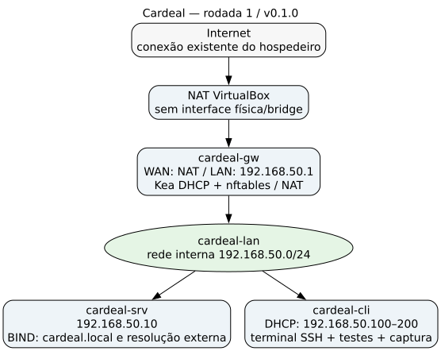

# Relatório técnico parcial — Cardeal Ltda

Versão `v0.2.0`, desenvolvida em 06/11/2026. O laboratório entrega rede básica, intranet e compartilhamento autenticado. O correio interno pertence à próxima sprint.

## Infraestrutura

| Máquina | Endereço e interfaces | Recursos | Funções entregues |
| --- | --- | --- | --- |
| `cardeal-gw` | WAN NAT e LAN `192.168.50.1/24` | 1 vCPU, 512 MiB RAM, disco 8 GiB | Kea DHCP, roteamento IPv4, nftables/NAT e salto SSH. |
| `cardeal-srv` | Somente LAN `192.168.50.10/24` | 2 vCPU, 1.024 MiB RAM, disco 16 GiB | BIND DNS, Apache HTTP, Samba e firewall LAN. |
| `cardeal-cli` | Somente LAN; DHCP observado `192.168.50.100/24` | 1 vCPU, 512 MiB RAM, disco 8 GiB | Cliente DHCP/DNS, HTTP, SMB e coleta de pacotes. |

O hospedeiro é Ubuntu 26.04, com VirtualBox base; os convidados usam Debian 13 sem desktop e swap de 1 GiB por VM. A LAN interna é `cardeal-lan`, domínio `cardeal.local`, pool DHCP `.100–.200`, gateway `.1` e DNS `.10`. Nenhuma alteração na configuração da conexão externa do Ubuntu foi necessária.

## Desenvolvimento e resultados por versão

O [relatório R1](../rodada-1/RELATORIO.md) detalha a imagem oficial com SHA-512, criação NoCloud, NICs, scripts de rede, DHCP/DNS, saída externa e as dificuldades resolvidas. A primeira sprint foi publicada no commit `de1cebb` (`feat: DHCP, DNS e gateway`). Seu [aceite](../../evidencias/v0.1.0/STATUS.md) permanece preservado.

O [relatório R2](../rodada-2/RELATORIO.md) detalha Web, Samba, contas, permissões, firewall, testes reais, persistência e captura HTTP. O [aceite atual](../../evidencias/v0.2.0/STATUS.md) relaciona todos os critérios da segunda sprint às evidências. O [README](../../README.md) documenta os comandos de operação.

## Protocolos e capturas

| Função | Aplicação/transporte | Captura e análise |
| --- | --- | --- |
| Configuração automática | DHCP / UDP 67–68 | [DHCP](../../wireshark/dhcp.pcapng): DORA nos quadros 2–5; origens/destinos em [análise](../../evidencias/v0.2.0/analise-dhcp.txt). |
| Resolução de nomes | DNS / UDP e TCP 53 | [DNS](../../wireshark/dns.pcapng): consulta A e resposta nos quadros 1/2, servidor `.10`; [análise](../../evidencias/v0.2.0/analise-dns.txt). |
| Intranet | HTTP / TCP 80 | [HTTP](../../wireshark/http.pcapng): handshake 1–3, GET/Host 4, resposta 200 no quadro 6; [análise](../../evidencias/v0.2.0/analise-http.txt). URL: `http://www.cardeal.local/`. |
| Arquivos | SMB2/SMB3 / TCP 445 | Ana envia, Bruno baixa e o SHA-256 coincide; autenticação e permissões em [teste](../../evidencias/v0.2.0/teste-intranet.txt). |
| Administração | SSH / TCP 22 | Acesso via gateway e chave exclusiva do laboratório. |
| Acesso externo | HTTPS / TCP 443 | Verificado no cliente; gateway é seu único caminho externo. |

IPv4 é a camada de rede usada nos fluxos demonstrados; Ethernet e ARP suportam o enlace na LAN. O HTTP foi mantido observável para a demonstração do GET exigida pelo enunciado. A captura ocorre no cliente porque o tráfego para o servidor não atravessa o gateway.

## Continuidade da entrega

Reinício e reaplicação preservaram dados, contas e permissões, com comparação anterior a novas transferências de teste. O estado e os registros constam no aceite R2. A próxima versão acrescentará Postfix/Dovecot, envio/leitura nos dois sentidos, captura SMTP/IMAP e reconstrução integral do laboratório; esses itens ainda não são resultados desta versão.
