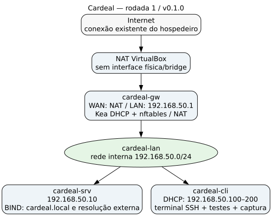

# Relatório da primeira rodada — v0.1.0

Execução e aceite em **05/11/2026**, no Ubuntu 26.04 LTS do projeto. Escopo: infraestrutura básica funcional com três VMs Debian 13 e cliente de terminal. A rodada está aprovada pelos testes reais registrados em [STATUS.md](../../evidencias/v0.1.0/STATUS.md).

## Infraestrutura implementada



| VM | Recursos configurados | Endereçamento final | Serviços/funções |
| --- | --- | --- | --- |
| `cardeal-gw` | 1 vCPU, 512 MiB RAM, disco 8 GiB, swap 1 GiB | WAN NAT `10.0.2.15/24`; LAN `192.168.50.1/24` | nftables, forwarding IPv4, NAT, Kea DHCPv4, salto SSH. |
| `cardeal-srv` | 2 vCPU, 1.024 MiB RAM, disco 16 GiB, swap 1 GiB | Somente LAN `192.168.50.10/24` | BIND 9 autoritativo e encaminhador de consultas externas. |
| `cardeal-cli` | 1 vCPU, 512 MiB RAM, disco 8 GiB, swap 1 GiB | Somente LAN; lease observado `192.168.50.100/24` | Cliente DHCP, DNS, curl, dig e dumpcap. |

A LAN é a rede interna VirtualBox `cardeal-lan`, com máscara `255.255.255.0`. O DHCP tem pool `.100–.200` e entrega gateway `.1`, DNS `.10` e domínio `cardeal.local`; endereços estáticos ficam fora desse pool. O endereço efetivo do cliente é consultado no lease, sem assumir que será sempre `.100`.

Somente o gateway tem WAN/NAT na topologia final. Cliente e servidor tiveram o adaptador NAT de bootstrap removido após a instalação dos pacotes. A administração externa usa redirecionamento **somente em `127.0.0.1:2222`** e SSH através do gateway.

## Desenvolvimento e reprodução

`lab.sh` chama a orquestração em `src/host/lab.py`. A imagem oficial Debian generic amd64, build `20261103-2651`, é fixada com URL e SHA-512 em [config/debian-image.json](../../config/debian-image.json). A imagem foi verificada antes da conversão RAW → VDI.

Uma ISO NoCloud por convidado define nome, interfaces iniciais, chave SSH do laboratório e marcador de papel. Esse bootstrap usa [NoCloud local](https://docs.cloud-init.io/en/latest/reference/datasources/nocloud.html), sem contratar nuvem. Após o bootstrap, os scripts de configuração exigem root, Debian 13, virtualização e o marcador do papel correto antes de alterar os serviços.

As configurações são geradas de `templates/`. A rede persistente dos convidados usa systemd-networkd e systemd-resolved. O DNS `.local` é encaminhado ao DNS unicast da LAN com mDNS/LLMNR desativados nos convidados; o teste inclui `getent`, usado pelas aplicações.

Os scripts foram reaplicados nas mesmas VMs durante a rodada.

```bash
./lab.sh preparar
./lab.sh iniciar
./lab.sh cliente
./lab.sh testar
```

No cliente é possível consultar os endereços/rotas, resolver `www.cardeal.local`, consultar MX de `cardeal.local` e acessar HTTPS externo. Os nomes `www`, `files` e `mail` já existem no BIND; suas aplicações serão implementadas nas sprints seguintes.

## Testes e resultados

O [aceite final](aceite-final.log) retornou aprovado depois de iniciar as VMs desligadas e abrir o [terminal do cliente](terminal-cliente.txt). O cliente recebeu os parâmetros corretos por DHCP, resolveu A/MX/PTR por UDP/TCP, resolveu o nome pelo caminho das aplicações e recebeu HTTP 200 de `https://deb.debian.org/debian/`.

O [reinício completo](reinicio.log) preservou as configurações e repetiu o teste funcional. No [teste de falha](../../evidencias/v0.1.0/teste-falha-gateway.txt), o gateway virtual foi desligado: a saída HTTPS falhou, enquanto o DNS interno continuou respondendo. Depois de religar o gateway, o acesso externo retornou com HTTP 200. Essa falha foi intencional e restrita ao laboratório.

O [registro de comparação do hospedeiro](../../evidencias/v0.1.0/rede-hospedeiro.json) tem hashes antes/depois iguais e `sem_alteracoes: true`. Foram comparados interfaces, endereços estáveis IPv4/IPv6, rotas IPv4 e configuração/link de resolv.conf. A implementação não executou configuração de bridge, host-only, DHCP, rotas, DNS, firewall ou NetworkManager no hospedeiro.

## Protocolos e análise das capturas

| Função | Aplicação | Transporte | Rede |
| --- | --- | --- | --- |
| Configuração automática | DHCP, servidor UDP 67 e cliente UDP 68 | UDP | IPv4 |
| Consulta de nomes | DNS, porta 53 | UDP e TCP | IPv4 |
| Administração | SSH, porta 22 no convidado | TCP | IPv4 |
| Acesso externo demonstrado | HTTPS, porta 443 | TCP | IPv4 |

Ethernet e ARP dão suporte ao enlace na LAN. NAT traduz os endereços no gateway; não é um protocolo de aplicação.

No [DHCP](../../wireshark/dhcp.pcapng), o quadro 1 registra o Release do desligamento anterior. O DORA completo está nos quadros 2–5: Discover de `0.0.0.0` para `255.255.255.255`, Offer do gateway para `.100`, Request em broadcast e ACK de `.1` para `.100`. O [ACK detalhado](../../evidencias/v0.1.0/dhcp-ack.txt) comprova máscara, router, DNS, domínio e identificador do servidor.

No [DNS](../../wireshark/dns.pcapng), os quadros 1/2 mostram consulta A de `www.cardeal.local` pelo cliente `.100` e resposta do servidor `.10`. Os quadros 6/8 mostram consulta/resposta MX de `cardeal.local` sobre TCP. Os demais quadros TCP suportam a conexão. As tabelas de [DHCP](../../evidencias/v0.1.0/analise-dhcp.txt) e [DNS](../../evidencias/v0.1.0/analise-dns.txt) foram extraídas das capturas reais.

## Recursos e dificuldades resolvidas

As três VMs ficaram simultaneamente em execução, com aproximadamente 2 GiB de RAM configurada no total. Nas medições registradas, todas tinham swap de 1 GiB com uso zero e espaço livre nos discos. A [amostra curta de vmstat do host](../../evidencias/v0.1.0/vmstat-host.txt), desconsiderando a primeira linha acumulada desde o boot, teve `si/so = 0` nas quatro amostras seguintes. Isso descreve esta execução, sem representar teste de carga.

Três ajustes foram necessários durante a implementação:

1. **Pasta com espaços e salto SSH.** O OpenSSH propagava o caminho absoluto de `-F` incorretamente ao ProxyJump. A automação passou a executar na raiz do projeto e usar o caminho relativo da configuração SSH. O terminal foi validado pelo comando público `./lab.sh cliente`.
2. **Prontidão após boot.** O SSH do cliente podia estar disponível antes do BIND. A inicialização agora aguarda os serviços do gateway e uma resposta DNS efetiva antes de anunciar o cliente pronto e executar o aceite.
3. **TShark e AppArmor no Ubuntu.** O perfil instalado não permitiu ler diretamente a captura na pasta do projeto. A análise usa uma cópia em diretório temporário permitido e a remove depois, preservando o perfil do sistema. O validador aceita os booleanos `True/False` emitidos pela versão instalada.

Pacotes dos convidados são instalados sem recomendações extras e há swap para o limite de RAM. As versões efetivas estão nos arquivos de recursos de [gateway](../../evidencias/v0.1.0/recursos-gateway.txt), [servidor](../../evidencias/v0.1.0/recursos-servidor.txt) e [cliente](../../evidencias/v0.1.0/recursos-cliente.txt).

## Entrega da rodada

A versão funcional local é `0.1.0`, registrada em `VERSION`. Estão entregues orquestração, scripts dos convidados, templates, topologia, capturas, análises e instruções de execução. O laboratório permaneceu ligado com cliente acessível. Web/SMB e correio interno continuam no escopo das Sprints 2 e 3.
