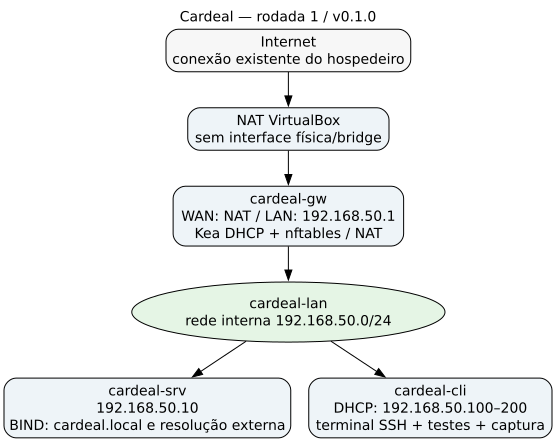

# Relatório da segunda rodada — v0.2.0

Implementação em **06/11/2026**, sobre as três VMs Debian 13 da primeira sprint. Esta rodada entrega a intranet HTTP e o compartilhamento SMB autenticado. As funções de rede da v0.1.0 continuam sendo verificadas pelo teste cumulativo. O estado e os vínculos das evidências estão em [STATUS.md](../../evidencias/v0.2.0/STATUS.md).

## Infraestrutura e aplicação

O gateway `192.168.50.1` continua com WAN NAT e LAN interna; o servidor `192.168.50.10` e o cliente DHCP `192.168.50.100` continuam com uma única interface LAN. Nenhuma nova VM, NIC ou publicação de porta no Ubuntu foi criada. O acesso administrativo permanece por SSH em `127.0.0.1:2222`, com salto pelo gateway.

`./lab.sh atualizar` transfere os scripts/templates e aplica a segunda rodada nas VMs existentes. `./lab.sh preparar` inclui a segunda rodada em novas preparações. A configuração R2 não chama a configuração de interfaces, DHCP, rotas ou resolvedores: instala os serviços e configura o firewall do convidado servidor. Nenhum pacote adicional foi instalado no hospedeiro nesta rodada.

### Intranet

O Apache serve `http://www.cardeal.local/`, com `ServerName` e VirtualHost explícitos, escutando no endereço LAN do servidor, porta TCP 80. O conteúdo fica em `/var/www/cardeal`, com página HTML e CSS locais, sem JavaScript ou recursos externos. A página apresenta a Cardeal, comunicados e o endereço da pasta compartilhada. O cliente acessa a página pelo DNS, sem substituir o nome pelo IP no teste.

A configuração segue a seleção de VirtualHost por endereço e nome documentada pelo [Apache HTTP Server](https://httpd.apache.org/docs/2.4/vhosts/name-based.html). A geração usa [templates/web](../../templates/web/) e [configurar-r2.sh](../../src/servidor/configurar-r2.sh).

### Identidades e arquivos

O servidor possui `ana` (UID 1001), `bruno` (UID 1002) e o grupo `funcionarios` (GID 1001), separados da conta administrativa `cardeal`. As contas Unix de funcionários não oferecem shell interativo nesta etapa. O Samba usa contas locais e autenticação própria, sem Active Directory.

O compartilhamento `//files.cardeal.local/compartilhado` aponta para `/srv/samba/compartilhado`. O diretório tem proprietário `root`, grupo `funcionarios` e modo `2770`; o setgid conserva o grupo nos novos objetos. O arquivo transferido tem modo `0660`, permitindo leitura/escrita pelos dois funcionários e negando acesso a outros usuários locais. O Samba aceita os membros do grupo, recusa convidados e exige SMB2/SMB3 com assinatura. Usa TCP 445, sem descoberta NetBIOS ou serviço de impressão.

As regras de compartilhamento e máscaras seguem o [manual smb.conf](https://www.samba.org/samba/docs/current/man-html/smb.conf.5.html); os testes usam os comandos de transferência e o arquivo de autenticação do [smbclient](https://www.samba.org/samba/docs/current/man-html/smbclient.1.html).

As senhas aleatórias são geradas uma vez em `secrets/intranet.json`, ignorado pelo Git, com modo `0600`. O diretório local tem modo `0700`. As cópias nos convidados ficam sob `/etc/cardeal`, restrito a root. O cliente usa arquivos de autenticação `ana.auth` e `bruno.auth`, protegidos, sem incluir a senha em argumentos de processo ou logs. A reaplicação reutiliza as credenciais existentes.

### Firewall

Na VM servidor, nftables permite, pela LAN, TCP 22/53/80/445 e UDP 53; também permite loopback, retorno de conexões e ICMP. O encaminhamento nessa VM fica bloqueado. O gateway conserva a política da primeira sprint, sem abertura de conexões novas da WAN para a LAN. Os detalhes efetivos de serviços, sockets e regras estão nos [validadores](../../evidencias/v0.2.0/validadores-servidor.txt).

## Testes funcionais

[testar-intranet.sh](../../src/testes/testar-intranet.sh) roda dentro do cliente e retorna erro se algum requisito falhar. O [registro real](../../evidencias/v0.2.0/teste-intranet.txt) demonstra:

1. Resolução de `www`/`files` em `192.168.50.10`; GET da página com HTTP 200 e marcador de conteúdo Cardeal; obtenção do CSS local.
2. Upload autenticado como Ana e download autenticado como Bruno, com comparação byte a byte e SHA-256 igual: `69587c5d7772a6fdaf9c4bed465f3c18785e4e476c178c29764894df6241bb37`.
3. Escrita de Bruno no arquivo criado por Ana e leitura posterior de Ana, comprovando a permissão compartilhada.
4. Senha incorreta recusada com `NT_STATUS_LOGON_FAILURE`; acesso anônimo ao compartilhamento recusado com `NT_STATUS_ACCESS_DENIED`.

`apache2ctl configtest`, `testparm` e a validação nftables retornaram sucesso. Apache, Samba, DNS e firewall ficaram ativos e habilitados no boot. O [inventário](../../evidencias/v0.2.0/inventario-intranet.json) confere uma única ocorrência de cada conta, os membros do grupo e as permissões do arquivo.

O teste da rede básica permanece em [teste-rede.txt](../../evidencias/v0.2.0/teste-rede.txt). A chamada `./lab.sh testar` no Ubuntu executa rede e intranet e também compara a rede do hospedeiro; a mesma chamada dentro do cliente executa os testes funcionais locais.

## Reinício e reaplicação

`./lab.sh testar-persistencia` executou o aceite inicial, inventariou os dados, desligou as três VMs por ACPI e iniciou-as novamente. Depois reaplicou os scripts R2 nas mesmas VMs. Em ambos os casos, comparou **antes de reenviar qualquer arquivo de teste** o SHA-256, tamanho, UID/GID, modos, diretórios, contas Unix/Samba e grupo. Os três inventários são iguais:

- [Antes](../../evidencias/v0.2.0/inventario-antes.json).
- [Após reinício](../../evidencias/v0.2.0/inventario-pos-reinicio.json).
- [Após reaplicação](../../evidencias/v0.2.0/inventario-pos-reaplicacao.json).

Web e SMB funcionaram após o reinício. A reaplicação não apagou arquivos nem duplicou contas ou configurações; as configurações são escritas em caminhos fixos, e os dados compartilhados não são recriados. [Resultado estruturado](../../evidencias/v0.2.0/persistencia.json) e [execução completa](persistencia.log).

## Captura HTTP e camadas

A captura [http.pcapng](../../wireshark/http.pcapng) foi feita na interface LAN do cliente, com filtro para o servidor e TCP 80. O tráfego cliente–servidor permanece na mesma sub-rede e não passa pelo gateway. Os quadros reais, do mesmo fluxo TCP, foram extraídos por TShark:

| Quadro | Origem → destino | Significado |
| --- | --- | --- |
| 1 | `192.168.50.100` → `192.168.50.10` | SYN: o cliente inicia a conexão TCP. |
| 2 | `192.168.50.10` → `192.168.50.100` | SYN/ACK: o servidor responde. |
| 3 | `192.168.50.100` → `192.168.50.10` | ACK: conclui o handshake. |
| 4 | `192.168.50.100` → `192.168.50.10` | Requisição `GET /` e `Host: www.cardeal.local`. |
| 6 | `192.168.50.10` → `192.168.50.100` | Resposta HTTP 200 com a página. |

A URL completa é reconstruída com o esquema HTTP, o campo Host e o caminho da requisição: **`http://www.cardeal.local/`**. [Tabela de campos](../../evidencias/v0.2.0/analise-http.txt) e [resumo estruturado](../../evidencias/v0.2.0/http.json).

HTTP e SMB são protocolos de aplicação e usam TCP sobre IPv4 nesta demonstração. Ethernet/ARP suportam o enlace local. A análise mantém a solução da R1 para o perfil AppArmor do TShark: lê uma cópia temporária da captura, preservando o original e o perfil de segurança do Ubuntu. As capturas anteriores DHCP/DNS foram reanalisadas com sucesso nesta versão.

## Operação e limites da entrega

No Ubuntu, use `./lab.sh iniciar`, `./lab.sh cliente`, `./lab.sh testar`, `./lab.sh testar-persistencia` e `./lab.sh capturar-http`. Dentro do cliente, `./lab.sh testar` verifica rede e intranet; `./lab.sh testar-intranet` verifica somente Web/SMB. O [README](../../README.md) inclui os comandos para troca manual de arquivos como Ana e Bruno.

A conferência pelo terminal do cliente detectou um ajuste necessário no atalho: o usuário administrativo não podia consultar diretamente o marcador em `/etc/cardeal`, cujo diretório é privado. O atalho passou a verificar esse marcador com `sudo -n test`, mantendo as credenciais protegidas. A repetição do [fluxo público](terminal-cliente.txt) confirmou os dois aceites na mesma sessão, sem reconfigurar a rede.

Na medição com os serviços ativos, o servidor apresentou 285 MiB usados e 681 MiB disponíveis; cliente, 108/355 MiB; gateway, 111/352 MiB. Todas as VMs apresentaram uso zero de swap. O servidor manteve aproximadamente 13 GiB de espaço livre. Os valores e versões efetivos constam nos arquivos de recursos de [servidor](../../evidencias/v0.2.0/recursos-servidor.txt), [cliente](../../evidencias/v0.2.0/recursos-cliente.txt) e [gateway](../../evidencias/v0.2.0/recursos-gateway.txt). A [amostra curta do hospedeiro](../../evidencias/v0.2.0/vmstat-host.txt) apresentou `si/so = 0` nos intervalos; isso registra a execução atual e não representa teste de carga.

A perda e recuperação do gateway da primeira sprint foi repetida e aprovada com os novos serviços instalados: o DNS interno continuou disponível, a conexão externa falhou com o gateway desligado e retornou após religá-lo. A bateria cumulativa voltou a aprovar rede, Web e SMB: [registro](../../evidencias/v0.2.0/teste-falha-gateway.txt) e [execução completa](falha-gateway.log).

A página e o compartilhamento são acessados pela LAN virtual; o navegador do Ubuntu não ganha acesso direto por esta implementação. A [comparação do hospedeiro](../../evidencias/v0.2.0/rede-hospedeiro.json) conserva interfaces, endereços estáveis, rotas IPv4 e resolv.conf. Não houve configuração de rede física, bridge, host-only, DNS, firewall ou NetworkManager no Ubuntu.

Os serviços de correio serão implementados na Sprint 3. O registro MX existente não comprova envio/leitura de mensagens nesta versão. A reconstrução integral em novas VMs mínimas também será comprovada na Sprint 3; nesta rodada foram efetivamente verificadas a atualização, o reinício e a reaplicação nas VMs existentes.
